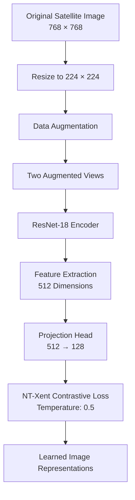
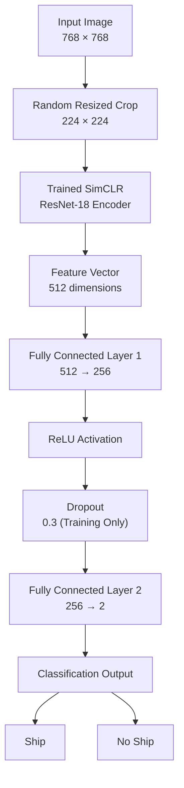

# Varuna-SSL

**Varuna-SSL** explores self-supervised representation learning, ship classification, and ship segmentation in maritime satellite imagery. The project investigates how visual representations learned from unlabelled imagery can support downstream maritime analysis.

The project uses the Airbus Ship Detection Challenge dataset and explores SimCLR-based representation learning with a ResNet-18 encoder, alongside supervised classification and segmentation experiments.

## Project Objectives

- Investigate self-supervised representation learning for maritime satellite imagery.
- Train a SimCLR model to learn visual representations without using ship labels during pretraining.
- Evaluate learned representations on downstream ship classification tasks.
- Fine-tune learned representations for improved ship classification.
- Develop a ship segmentation model using a ResNet-18-based architecture.
- Analyze model performance across different ship sizes and image-coverage percentages.

## Current Implementation

The project currently includes:

- Dataset downloading, image validation, and annotation analysis utilities.
- Dataset exploration and visualization.
- Stratified training, validation, and test splits.
- SimCLR-based self-supervised representation learning.
- Downstream evaluation using a linear classifier trained on frozen representations.
- Fine-tuning of the SimCLR encoder for binary ship classification.
- Analysis of classification errors, false negatives, and feature representations.
- Ship-coverage-based evaluation to understand the effect of ship size on classification and segmentation.
- A ResNet-18-based ship segmentation model with a decoder and skip connections.
- Segmentation training using weighted binary cross-entropy and Dice loss.
- Segmentation evaluation using Dice, Intersection over Union (IoU), and ship detection rate.

## Requirements

- Linux development environment.
- Python 3.12.15 or newer, as specified by `pyproject.toml`.
- [uv](https://docs.astral.sh/uv/).
- NVIDIA GPU with a compatible driver for CUDA-accelerated training.
- Kaggle account with access to the Airbus Ship Detection Challenge.
- Sufficient storage for the dataset and model checkpoints.

## Environment Setup

Clone the repository and enter the project directory:

```bash
git clone https://github.com/Abhi-A-S/varuna-ssl.git
cd varuna-ssl
```

Install the project and its dependencies:

```bash
uv sync
```

You can also execute registered project commands directly through `uv run` without manually activating the environment.

## Kaggle Authentication

1. Sign in to [Kaggle](https://www.kaggle.com/).
2. Open [Kaggle Settings](https://www.kaggle.com/settings).
3. Configure API authentication using the method supported by your installed Kaggle CLI.
4. Accept the competition rules.

Verify authentication and dataset access:

```bash
kaggle config view
kaggle competitions files -c airbus-ship-detection
```

Do not commit API credentials or share authentication tokens.

## Dataset Utilities

Run these commands from the project root:

| Command                   | Description                                             |
| ------------------------- | ------------------------------------------------------- |
| `uv run download-dataset` | Downloads the dataset archive into `./raw`.             |
| `uv run verify-images`    | Verifies image integrity, dimensions, and colour modes. |
| `uv run analyze-dataset`  | Analyzes annotations and checks image-file consistency. |

Extract the downloaded archive before running the image verification and dataset analysis commands.

## Notebook Workflow

The notebooks contain exploratory analysis, model development, training, and evaluation experiments.

| Notebook                                   | Purpose                                                              |
| ------------------------------------------ | -------------------------------------------------------------------- |
| `01_dataset_exploration.ipynb`             | Dataset inspection, annotation analysis, and visualization.          |
| `02_simclr_baseline.ipynb`                 | Earlier SimCLR model development experiments.                        |
| `03_simclr_baseline_test.ipynb`            | Earlier SimCLR evaluation and testing.                               |
| `04_ship_segmentation.ipynb`               | Initial ship segmentation experiments.                               |
| `05_full_training_ship_segmentation.ipynb` | Full-dataset segmentation training.                                  |
| `06_segmentation_evaluation.ipynb`         | Segmentation evaluation and coverage-based analysis.                 |
| `07_simclr_full_dataset.ipynb`             | Full-dataset SimCLR pretraining and linear-probe evaluation.         |
| `08_simclr_model_analysis.ipynb`           | Feature analysis, PCA, prototypes, and false-negative investigation. |
| `09_finetune_simclr_classifier.ipynb`      | Fine-tuning the SimCLR encoder for binary ship classification.       |

## Pretrained Models and Experiment Artifacts

Trained model checkpoints and experiment artifacts are distributed separately through GitHub Releases to keep the source repository lightweight.

<details>
<summary>Available model release — v1</summary>

**[Download Varuna-SSL Model Checkpoints v1](https://github.com/Abhi-A-S/varuna-ssl/releases/tag/models-v1)**

The release contains:

- SimCLR pretrained model.
- Fine-tuned ship classification model.
- Ship segmentation model.
- Training histories and evaluation CSV files.

</details>

### Download and Installation

1. Visit the [GitHub Releases](https://github.com/Abhi-A-S/varuna-ssl/releases) page.
2. Download `varuna-ssl-models-v1.zip`.
3. Extract the archive into the project root.

The archive contains a `checkpoints/` directory with the model weights and experiment artifacts.

```text
varuna-ssl/
├── checkpoints/
│   ├── simclr_best.pt
│   ├── simclr_classifier_best.pt
│   ├── varuna_segmentation_full_dataset_epoch1.pt
│   ├── simclr_training_history.csv
│   ├── simclr_step_history.csv
│   ├── simclr_test_results.csv
│   └── simclr_classifier_history.csv
├── notebooks/
├── scripts/
├── pyproject.toml
└── README.md
```

For detailed information about the models, checkpoint files, and loading requirements, refer to [MODEL_ARTIFACTS.md](MODEL_ARTIFACTS.md).

### Checkpoint Storage

Model weights, generated training histories, and experimental artifacts are excluded from Git using `.gitignore`. They are distributed through GitHub Releases instead.

## Dataset

The project uses the [Airbus Ship Detection Challenge dataset](https://www.kaggle.com/c/airbus-ship-detection/data).

The dataset contains satellite imagery and run-length-encoded (RLE) segmentation annotations for ship masks.

### Dataset Statistics

| Description                     |   Count |
| ------------------------------- | ------: |
| Unique labelled training images | 192,556 |
| Images containing ships         |  42,556 |
| Images without ships            | 150,000 |
| Annotation rows                 | 231,723 |
| Non-empty mask rows             |  81,723 |
| Empty mask rows                 | 150,000 |

### Dataset Split

The labelled images were divided into stratified training, validation, and test sets for the SimCLR and classification experiments.

| Split      | Total Images |     No Ship |       Ship |
| ---------- | -----------: | ----------: | ---------: |
| Training   |      134,789 |     105,000 |     29,789 |
| Validation |       28,883 |      22,500 |      6,383 |
| Test       |       28,884 |      22,500 |      6,384 |
| **Total**  |  **192,556** | **150,000** | **42,556** |

The test images used for internal evaluation are held-out labelled images from the original training dataset. The competition's separate `test_v2` images do not include ground-truth ship masks.

The segmentation experiments use their own 800-image validation splits, as described in the segmentation section.

After downloading and extracting the dataset, the expected directory structure is:

```text
raw/
└── airbus-ship-detection/
    ├── train_v2/
    ├── test_v2/
    ├── train_ship_segmentations_v2.csv
    └── sample_submission_v2.csv
```

## SimCLR Self-Supervised Learning

SimCLR is used to learn visual representations from maritime satellite images without using ship annotations during pretraining.

The model uses a ResNet-18 encoder and a projection head. Two augmented views of each image are passed through the network, and the NT-Xent contrastive loss encourages representations of the same image to be similar while separating representations of different images.

### Model Architecture

- **Encoder:** ResNet-18, initialized without pretrained ImageNet weights.
- **Projection head:** Fully connected layers mapping the encoder representation to a 128-dimensional projection.
- **Loss function:** Normalized Temperature-Scaled Cross Entropy (NT-Xent).
- **Temperature:** 0.5.
- **Input resolution:** 224 × 224 pixels.



### Training Configuration

| Parameter            |           Value |
| -------------------- | --------------: |
| Training images      |         134,789 |
| Batch size           |              32 |
| Epochs               |               5 |
| Optimizer            |           AdamW |
| Learning rate        |          0.0003 |
| Weight decay         |          0.0001 |
| Projection dimension |             128 |
| Temperature          |             0.5 |
| Mixed precision      | Enabled on CUDA |

The encoder was trained on the full training split using augmented image pairs. Ship labels were not used during contrastive pretraining.

### SimCLR Training Results

The model was trained for five epochs. Training loss decreased throughout training, while validation performance was monitored using a linear-probe evaluation.

_Refer to `checkpoints/simclr_training_history.csv` for the complete training history._

The best validation PR-AUC of **0.8387** was achieved at epoch 5.

### Downstream Linear-Probe Evaluation

To evaluate the learned representations, the SimCLR encoder was frozen and image features were extracted. A separate linear classifier was trained using these features to distinguish between ship and no-ship images.

The held-out test set contained 28,884 images, including 6,384 ship-containing images and 22,500 images without ships.

| Metric    | No Ship |   Ship |
| --------- | ------: | -----: |
| Precision |  0.9459 | 0.6831 |
| Recall    |  0.8920 | 0.8203 |
| F1-score  |  0.9182 | 0.7455 |

| Overall Metric    | Result |
| ----------------- | -----: |
| Accuracy          | 87.62% |
| Macro F1-score    | 0.8318 |
| Weighted F1-score | 0.8800 |

The confusion matrix was:

|                | Predicted No Ship | Predicted Ship |
| -------------- | ----------------: | -------------: |
| Actual No Ship |            20,071 |          2,429 |
| Actual Ship    |             1,147 |          5,237 |

These results show that the learned representations contain useful information for downstream ship classification. However, the classifier performs better on no-ship images than on ship-containing images.

### Analysis of Ship Coverage

The test set was further analyzed by grouping ship-containing images according to the percentage of the original image occupied by ground-truth ship masks.

| Ship Coverage | Images | Correctly Detected | Missed | Recall (%) |
| ------------- | -----: | -----------------: | -----: | ---------: |
| <0.01%        |    375 |                277 |     98 |      73.87 |
| 0.01–0.05%    |  1,536 |              1,086 |    450 |      70.70 |
| 0.05–0.1%     |    613 |                476 |    137 |      77.65 |
| 0.1–0.5%      |  1,894 |              1,597 |    297 |      84.32 |
| 0.5–1%        |    884 |                803 |     81 |      90.84 |
| 1–2%          |    748 |                688 |     60 |      91.98 |
| 2–5%          |    327 |                303 |     24 |      92.66 |
| >5%           |      7 |                  7 |      0 |     100.00 |

#### Observations

- Ship-containing images with lower coverage are more difficult to classify correctly.
- Recall generally improves as ship coverage increases.
- Images with coverage below 0.1% have lower detection recall than images containing larger ships.
- The results suggest that small ships and limited visual features remain challenging for the learned representations.
- The group containing more than 5% ship coverage has only seven images, so its result should not be generalized.

### Representation Analysis

Additional analysis was performed on the learned feature representations, including:

- Feature extraction from the frozen SimCLR encoder.
- Linear classification using the extracted features.
- Principal Component Analysis (PCA) for dimensionality reduction and visualization.
- Class prototype similarity analysis.
- False-negative inspection.
- Analysis of classification performance across ship-coverage groups.

These analyses help investigate how the learned representations distinguish ship-containing images from images without ships.

## Fine-Tuned SimCLR Ship Classifier

In addition to the frozen linear-probe experiment, the learned SimCLR encoder was fine-tuned for binary ship classification.

The classifier loads the encoder weights from `simclr_best.pt` and attaches a classification head. Unlike the linear-probe experiment, the encoder is also updated during training.

### Model Architecture

- **Encoder:** ResNet-18 initialized from the trained SimCLR checkpoint.
- **Classification head:** Fully connected layers with 512 → 256 → 2 dimensions.
- **Activation:** ReLU.
- **Dropout:** 0.3.
- **Output:** Two classes — ship and no ship.
- **Input resolution:** 224 × 224 pixels.



### Training Configuration

| Parameter                |                  Value |
| ------------------------ | ---------------------: |
| Training split           |         134,789 images |
| Batch size               |                     32 |
| Epochs                   |                     10 |
| Optimizer                |                  AdamW |
| Encoder learning rate    |                0.00001 |
| Classifier learning rate |                  0.001 |
| Weight decay             |                 0.0001 |
| Loss function            | Weighted Cross Entropy |
| Learning-rate scheduler  |      ReduceLROnPlateau |
| Mixed precision          |        Enabled on CUDA |

Class weights were used to account for the imbalance between ship and no-ship images.

The encoder and classification head used separate learning rates, allowing the pretrained encoder to be fine-tuned more conservatively than the newly initialized classification head.

### Training Results

The best validation Average Precision was achieved at epoch 9.

| Metric                 | Result |
| ---------------------- | -----: |
| Best validation AP     | 0.9464 |
| Best epoch             |      9 |
| Test accuracy          | 93.77% |
| Test Average Precision | 94.09% |
| Test ROC-AUC           | 0.9808 |

### Test Classification Report

| Metric    | No Ship |   Ship |
| --------- | ------: | -----: |
| Precision |  0.9748 | 0.8235 |
| Recall    |  0.9444 | 0.9140 |
| F1-score  |  0.9594 | 0.8664 |

| Overall Metric    | Result |
| ----------------- | -----: |
| Accuracy          | 93.77% |
| Macro F1-score    | 0.9129 |
| Weighted F1-score | 0.9388 |

The confusion matrix was:

|                | Predicted No Ship | Predicted Ship |
| -------------- | ----------------: | -------------: |
| Actual No Ship |            21,249 |          1,251 |
| Actual Ship    |               549 |          5,835 |

### Observations

- Fine-tuning improves classification performance compared with the frozen linear-probe baseline.
- Ship recall increases to 91.40%, indicating improved identification of ship-containing images.
- The classifier achieves a test Average Precision of 94.09%.
- Small ships remain more challenging than larger ships, although the fine-tuned model improves detection across the coverage groups.

The fine-tuned classifier is a binary image-level classifier. It predicts whether an image contains a ship; it does not produce ship locations or segmentation masks.

The training history is stored in `checkpoints/simclr_classifier_history.csv`, and the best model is stored in `checkpoints/simclr_classifier_best.pt`.

## Ship Segmentation

The project also includes a ResNet-18-based ship segmentation model with a decoder and skip connections.

The model produces pixel-level predictions for ship regions in satellite images.

### Model Architecture

- **Encoder:** ResNet-18.
- **Decoder:** Convolutional upsampling blocks with skip connections.
- **Output:** Single-channel segmentation mask.
- **Input resolution:** 256 × 256 pixels.
- **Upsampling:** Bilinear interpolation.
- **Loss function:** Weighted binary cross-entropy combined with Dice loss.

The segmentation experiment initializes its ResNet-18 encoder from randomly initialized weights. It does not load the trained SimCLR encoder checkpoint.

### Training Configuration

| Parameter           |     Value |
| ------------------- | --------: |
| Training images     |   191,756 |
| Validation images   |       800 |
| Batch size          |        16 |
| Epochs              |         1 |
| Optimizer           |     AdamW |
| Learning rate       |    0.0001 |
| Weight decay        |    0.0001 |
| BCE positive weight |        10 |
| Input resolution    | 256 × 256 |

The model was trained using the full training dataset, excluding the reserved validation images.

### Segmentation Training Results

The training notebook evaluates the model on its stratified 800-image validation split.

At a prediction threshold of `0.50`, the results were:

| Metric           | Result |
| ---------------- | -----: |
| Pixel-level Dice | 0.6242 |
| Pixel-level IoU  | 0.4537 |

The validation loss after training was 0.1915.

### Separate Segmentation Evaluation

A separate evaluation notebook loads the saved full-dataset segmentation checkpoint and evaluates it using an 800-image validation split constructed directly from the complete set of image IDs.

This evaluation produced:

| Metric                 |    Result |
| ---------------------- | --------: |
| Pixel-level Dice       |    0.5416 |
| Pixel-level IoU        |    0.3713 |
| Empty-image accuracy   |    98.06% |
| Correctly empty images | 606 / 618 |

**Note:** The training notebook and evaluation notebook construct their validation splits differently. Although both contain 800 images, including 182 ship-containing images and 618 images without ships, their validation image IDs are not established to be identical. Therefore, these results are reported separately and should not be treated as a direct comparison.

### Segmentation Performance by Ship Coverage

The separate evaluation experiment also analyzes segmentation performance according to the percentage of each original image occupied by ground-truth ship masks.

| Ship Coverage | Images | Dice (%) | IoU (%) | Ship Detection (%) |
| ------------- | -----: | -------: | ------: | -----------------: |
| No ships      |    618 |      N/A |     N/A |                N/A |
| 0–0.01%       |      8 |     0.00 |    0.00 |              25.00 |
| 0.01–0.05%    |     44 |     3.64 |    1.85 |              38.64 |
| 0.05–0.1%     |     16 |     9.32 |    4.89 |              56.25 |
| 0.1–0.5%      |     70 |    55.05 |   37.98 |              84.29 |
| 0.5–1%        |     20 |    74.90 |   59.87 |             100.00 |
| 1–2%          |     13 |    73.66 |   58.30 |              92.31 |
| 2–5%          |     10 |    75.59 |   60.76 |              90.00 |
| >5%           |      1 |    13.75 |    7.38 |             100.00 |

**Metrics:**

- **Dice:** Measures pixel-level overlap between predicted and ground-truth masks.
- **IoU:** Measures the intersection of predicted and ground-truth masks relative to their union.
- **Ship Detection:** Percentage of ship-containing images in a coverage group where the model predicted at least one ship pixel.

The `No ships` group is excluded from ship detection rate because it contains no ground-truth ships. Its empty-image performance is reported separately.

#### Observations

- Small ships are difficult to segment. Images with ship coverage below 0.1% show low Dice and IoU scores.
- Performance generally improves with ship coverage.
- Detection does not guarantee accurate segmentation. The single image in the >5% group has a 100% detection rate but only 13.75% Dice.
- Higher-resolution inputs and ship-centred crops are potential approaches for preserving small-ship details.

These results are initial segmentation experiments. Further experiments are needed to establish whether alternative input resolutions and training strategies improve performance.

## Limitations and Future Work

Current experiments indicate that small ships are challenging for both representation-based classification and segmentation.

Potential future investigations include:

- Evaluating higher-resolution inputs and ship-centred crops.
- Investigating alternative augmentation strategies for maritime imagery.
- Exploring improved downstream classification and segmentation approaches.
- Evaluating the use of learned SimCLR representations for segmentation.
- Investigating whether the learned representations can support more detailed maritime analysis.

## License and Dataset Terms

This project is an academic research project. Refer to the dataset provider's terms and conditions for permitted use and redistribution of the Airbus Ship Detection Challenge data.

Third-party dataset files, downloaded imagery, credentials, and local environment files should not be committed to the repository.
